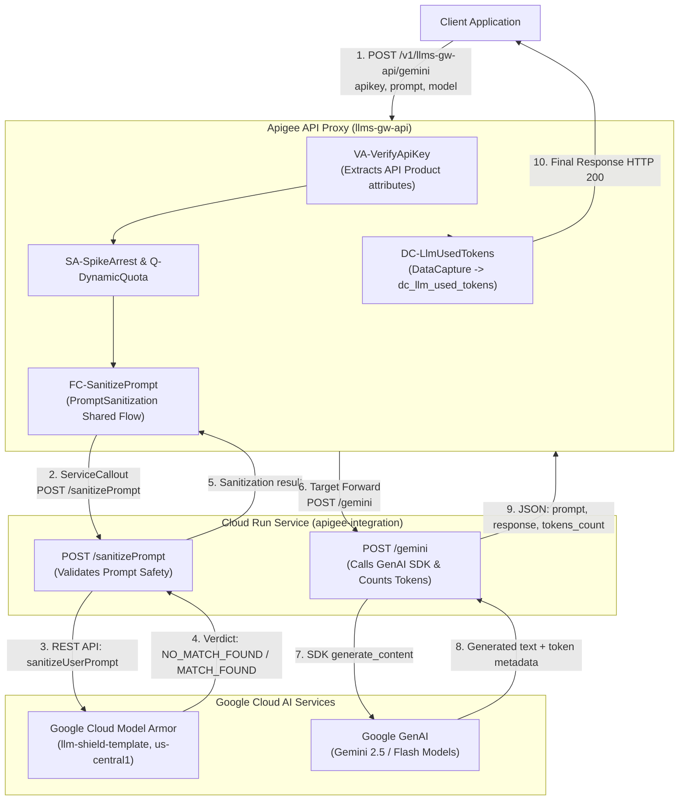
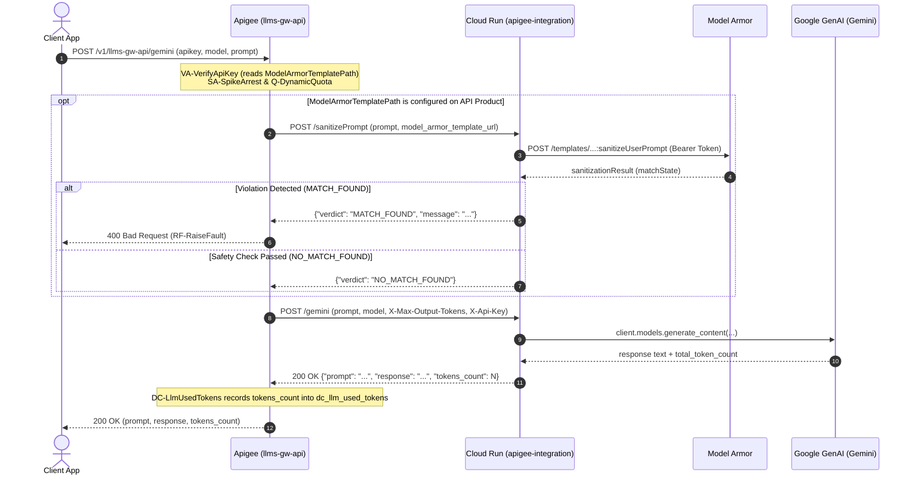

# Apigee LLM Gateway & Security Guardrails

Enterprise AI Gateway solution built on Google Cloud Apigee, Cloud Run, Google GenAI (Gemini), and Google Cloud Model Armor.

---

## Architecture Diagram



### Sequence Diagram



---

## Repository Structure

```
.
├── README.md                              # Root repository documentation & architecture
├── .gitignore                             # Git ignore rules
├── llms-gw-api_rev20_2026_10_07/          # Apigee API Proxy bundle (/v1/llms-gw-api)
│   └── apiproxy/                          # Policies, proxies, and target endpoints
├── PromptSanitization_rev4_2026_10_07/    # Apigee Shared Flow bundle
│   └── sharedflowbundle/                  # Service Callout & Raise Fault policies
├── model-armor/                           # Model Armor security template configurations
│   └── llm-shield-template-importable.json # Importable template configuration
└── integration/                           # Cloud Run backend microservice
    ├── main.py                            # Flask application (/gemini, /sanitizePrompt)
    ├── pyproject.toml                     # Python dependencies (uv)
    ├── uv.lock                            # Dependency lockfile
    └── README.md                          # Backend service documentation
```

---

## Request Flow Overview

1. **Client Request:** Client calls the Apigee proxy endpoint (`POST /v1/llms-gw-api/gemini`) with an API key, target model, and prompt.
2. **Authentication & Rate Limiting:**
   - `VA-VerifyApiKey` validates credentials and extracts API Product attributes (`ModelArmorTemplatePath`, `max_output_tokens`).
   - `SA-SpikeArrest` and `Q-DynamicQuota` enforce traffic management policies.
3. **Prompt Sanitization:**
   - If `ModelArmorTemplatePath` is configured, Apigee invokes `FC-SanitizePrompt` (Shared Flow).
   - The shared flow issues a `ServiceCallout` to the Cloud Run `/sanitizePrompt` endpoint.
   - Cloud Run invokes Google Cloud Model Armor (`:sanitizeUserPrompt`) to inspect for prompt injection, jailbreaks, malicious URLs, and safety violations.
   - If a violation is detected (`MATCH_FOUND`), a `400 Bad Request` fault is raised and execution stops.
4. **LLM Generation:**
   - When the prompt passes safety checks, Apigee forwards the request to Cloud Run (`POST /gemini`).
   - Cloud Run uses the `google-genai` SDK to generate content with the Gemini model.
5. **Analytics & Data Capture:**
   - The response includes the generated text and `tokens_count`.
   - `DC-LlmUsedTokens` captures the consumed token count into the Apigee Data Collector (`dc_llm_used_tokens`).
   - Apigee returns the final response (HTTP 200) to the client.
